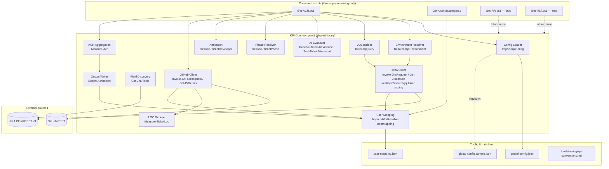

# Design Document

## Overview

The AI KPI Toolkit is a Windows PowerShell command-line solution that measures engineering KPIs from JIRA Cloud (primary source) and GitHub (secondary source). This phase delivers the AI Contribution Rate (ACR) end-to-end plus the shared infrastructure that the future Review Rate (RR) and Mean Lead Time (MLT) KPIs will reuse.

The architecture follows a strict rule: **all shared logic lives in one module (`KPI.Common.psm1`); each KPI or mapping is exactly one thin command script.** A command script only wires parameters to the shared library in a fixed sequence: *param block → import config → resolve environment → fetch → transform → aggregate → output*.

Only four command files are permitted:

| File | Purpose | Implemented this phase |
| --- | --- | --- |
| `Get-ACR.ps1` | AI Contribution Rate | Yes |
| `Get-UserMapping.ps1` | Link GitHub + JIRA + AWS identities | Yes |
| `Get-RR.ps1` | Review Rate | Stub (future) |
| `Get-MLT.ps1` | Mean Lead Time | Stub (future) |

**Design-to-requirements map (section → requirements):**

- File Layout & Command Design → R13
- Configuration Model & `Import-KpiConfig` → R1
- Environment Resolution → R2
- JIRA Client (`/rest/api/3/search/jql` token paging, Epic skip) → R3, R5 (fields), R6.4, R7, R10
- Field Discovery → R4
- AI-Assisted Evaluator (config marker, multi-shape field) → R5
- Phase Resolver → R6
- Attribution → R7
- Filter Engine / JQL Builder (resolved-or-UAT-passed window, Epic exclusion) → R8
- GitHub Client & LOC Dedupe → R10
- ACR Aggregation → R9
- Output Writer → R11
- User Mapping → R12
- Steering File → R14

---

## Architecture



### Module boundaries

- **Exported** functions (public API consumed by command scripts): `Import-KpiConfig`, `Resolve-KpiEnvironment`, `Get-JiraFields`, `Build-JqlQuery`, `Get-JiraIssues`, `Measure-TicketLoc`, `Measure-Acr`, `Export-AcrReport`, `Import-UserMapping`, `Add-UserMapping`, `Resolve-UserMapping`.
- **Private** helpers (dot-sourced inside the module, not exported): `Invoke-JiraRequest`, `Join-JiraUri`, `Get-ConfigValue`, `Measure-ConfigCount`, `ConvertTo-KpiTicket`, `Resolve-TicketAiEvidence`, `Test-TicketAiAssisted`, `Resolve-TicketPhase`, `Resolve-TicketDeveloper`, `Invoke-GitHubRequest`, `Get-IssueDevPrs`, `Get-PrDetails`, `Find-PrByKey`, `New-KpiError`.
- `Resolve-TicketAiEvidence` is the private evidence evaluator that returns both `IsAssisted` and `Source`; `Test-TicketAiAssisted` is a thin boolean wrapper over it. Both stay private because command scripts consume AI evidence only through the normalized ticket produced by `Get-JiraIssues`.
- `Build-JqlQuery` is **exported** because `Get-ACR.ps1` wires it directly in its fetch stage; PowerShell module scoping makes only exported functions callable from a command script, so the JQL builder must be part of the public surface. RR/MLT reuse the same exported builder.

This keeps the public surface small and consistent while allowing RR/MLT to call the same exported fetch/aggregate/output helpers.

---

## Components and Interfaces

All functions use `[CmdletBinding()]`, typed parameters, and emit terminal errors via a single `New-KpiError` helper (which calls `throw` with a structured message) so command scripts can stop cleanly. "Stop command execution" in requirements maps to a thrown terminating error caught at the top of each command script.

### Config Loader — `Import-KpiConfig` (R1)

```powershell
# Reads, parses, and validates global-config.json. Returns a validated config object.
function Import-KpiConfig {
    [CmdletBinding()]
    param([Parameter(Mandatory)][string]$Path)

    if (-not (Test-Path $Path)) { New-KpiError "Config file not found: $Path" }       # 1.10 path context
    try   { $cfg = Get-Content $Path -Raw | ConvertFrom-Json }
    catch { New-KpiError "Config file is not valid JSON: $Path. $($_.Exception.Message)" } # 1.10

    # Required-key table: dotted path -> human name. Drives 1.8/1.9 validation + naming.
    $required = @(
        'environments.test.baseUrl','environments.test.email','environments.test.apiToken',
        'environments.live.baseUrl','environments.live.email','environments.live.apiToken',
        'github.baseUrl','github.token',
        'phaseKeywordMap','validTargetBranches','aiEvidencedFieldId',
        'uatPassedStatus'                                                            # 1.12 required UAT-passed status
    )
    foreach ($key in $required) {
        if ([string]::IsNullOrWhiteSpace((Get-ConfigValue $cfg $key))) {
            New-KpiError "Missing or empty configuration key: $key"                   # 1.9 names key, stops
        }
    }
    return $cfg
}
```

- `Get-ConfigValue` resolves a dotted path; collections (phaseKeywordMap, validTargetBranches) are checked for non-empty rather than string-empty.
- `uatPassedStatus` is a **required** key (R1.12); its configured default is `UAT Passed`.
- `aiAssistedValue` is an **optional** key (R1.11): it is not in the required list and is defaulted to `AI-Assisted` by the consumers (`ConvertTo-KpiTicket` / `Resolve-TicketAiEvidence`) when absent or empty, so an existing config stays valid without it.
- Satisfies R1.1–R1.12. The two environments (`test`, `live`) and all source blocks are required; a missing key is named and halts execution.

### Environment Resolver — `Resolve-KpiEnvironment` (R2)

```powershell
# Validates -Environment and returns the matching environment block (default: test).
function Resolve-KpiEnvironment {
    [CmdletBinding()]
    param([object]$Config, [string]$Environment = 'test')
    if ($Environment -notin @('test','live')) {
        New-KpiError "Invalid -Environment '$Environment'. Accepted values: test, live." # 2.3
    }
    return $Config.environments.$Environment  # 2.1/2.2/2.4 — supplies baseUrl/email/apiToken
}
```

The parameter is declared with `[ValidateSet('test','live')]` on each command script for shell-level completion; `Resolve-KpiEnvironment` re-validates so the library is safe when called from RR/MLT.

### JIRA Client — `Invoke-JiraRequest` / `Get-JiraIssues` (R3, R7, R10)

```powershell
# Private: single authenticated JIRA call with basic auth (email:token), returns parsed body.
function Invoke-JiraRequest {
    param([object]$Env, [string]$Path, [hashtable]$Query, [string]$Method = 'GET')
    $pair  = "$($Env.email):$($Env.apiToken)"
    $basic = [Convert]::ToBase64String([Text.Encoding]::UTF8.GetBytes($pair))         # 3.1 basic auth
    $headers = @{ Authorization = "Basic $basic"; Accept = 'application/json' }
    try {
        return Invoke-RestMethod -Uri (Join-JiraUri $Env.baseUrl $Path $Query) -Headers $headers -Method $Method
    } catch {
        $status = $_.Exception.Response.StatusCode.value__
        if ($status -in 401,403) { New-KpiError "JIRA authentication failed ($status) for $Path." }      # 3.4
        New-KpiError "JIRA request failed ($status) for $Path. $($_.Exception.Message)"                   # 3.5
    }
}

# Exported: fetch all tickets for a JQL via the enhanced /rest/api/3/search/jql endpoint, following token paging and normalizing each ticket.
function Get-JiraIssues {
    param([object]$Env, [string]$Jql, [object]$Config)
    # issuetype is requested so the defensive Epic guard can read it; the AI field feeds R5 evaluation.
    $fields = "summary,labels,assignee,project,parent,issuetype,$($Config.aiEvidencedFieldId)"
    $all = @(); $pageToken = $null; $max = 100
    do {
        $query = @{ jql=$Jql; maxResults=$max; fields=$fields }
        if ($pageToken) { $query.nextPageToken = $pageToken }                         # 3.6 continue from previous page
        $resp = Invoke-JiraRequest $Env '/rest/api/3/search/jql' $query               # enhanced endpoint (legacy /search retired -> HTTP 410)
        foreach ($issue in @($resp.issues)) {
            if ($issue.fields -and $issue.fields.issuetype -and $issue.fields.issuetype.name -eq 'Epic') { continue } # 6.4 defensive Epic skip
            $all += (ConvertTo-KpiTicket $issue $Config)
        }
        $pageToken = $resp.nextPageToken                                              # 3.6 null/absent on the last page
    } while ($pageToken)                                                             # page until no token remains
    return $all
}
```

The JIRA search endpoint was migrated from the retired `/rest/api/3/search` (startAt/total paging — Atlassian now returns **HTTP 410 Gone**) to the enhanced `/rest/api/3/search/jql`, which pages by an opaque `nextPageToken` instead of numeric offsets. `Get-JiraIssues` requests the first page without a token and continues while the response carries a `nextPageToken`.

`ConvertTo-KpiTicket` (private) builds a normalized ticket: `Key`, `Summary`, `IssueType`, `Project` (3→7.3), `Developer` (via `Resolve-TicketDeveloper`), `IsAiAssisted` and `AiSource` (via `Resolve-TicketAiEvidence`), `Phase` (via `Resolve-TicketPhase`), and raw dev-panel/PR data. Paging (R3.6), auth failure (R3.4), and non-success HTTP (R3.5) are handled centrally. Epics are excluded both by the JQL `issuetype != Epic` clause and by the defensive in-loop skip above (R6.4), so an Epic is never counted as a ticket.

### Field Discovery — `Get-JiraFields` (R4)

```powershell
# Queries /rest/api/3/field and resolves the "AI Evidenced" custom field id for config population.
function Get-JiraFields {
    [CmdletBinding()]
    param([object]$Env, [string]$FieldName = 'AI Evidenced')
    $fields = Invoke-JiraRequest $Env '/rest/api/3/field'                               # 4.1
    $match  = $fields | Where-Object { $_.name -eq $FieldName } | Select-Object -First 1 # 4.2
    if (-not $match) { return "Field '$FieldName' not found." }                          # 4.4
    return $match.id   # 4.3 — present the id so it can be recorded in config (aiEvidencedFieldId)
}
```

### AI-Assisted Evaluator — `Resolve-TicketAiEvidence` / `Test-TicketAiAssisted` (R5)

The marker value is **config-driven**: `aiAssistedValue` (default `AI-Assisted`, hyphenated to match the user's real JIRA) is the single marker compared, under a trimmed case-insensitive **exact** match, against both the AI Evidenced field and the Labels fallback.

Precedence: a present, non-empty AI Evidenced field is authoritative and **overrides** Labels — if any field candidate matches the marker the ticket is assisted (`Source=AIEvidenced`), and if the field is present and non-empty but no candidate matches, the ticket is not assisted (`Source=None`) and Labels are **not** consulted. Only an empty or absent field falls back to a trimmed case-insensitive exact label match (`Source=Label`). An absent field never raises an error.

The AI Evidenced custom field can be returned by JIRA as a plain **string**, an **option object** exposing a `.value` member, or an **array** of either shape (a multi-select / multi-value field). `Resolve-TicketAiEvidence` flattens every shape into comparable candidate strings and matches any candidate against the marker. It returns both the boolean and the evidence source so callers can show *why* a ticket was classified: `@{ IsAssisted = <bool>; Source = 'AIEvidenced' | 'Label' | 'None' }`.

```powershell
# Returns IsAssisted + Source. AssistedValue is the configured marker; defaults to 'AI-Assisted'.
function Resolve-TicketAiEvidence {
    param([object]$Ticket, [string]$AiFieldId, [string]$AssistedValue = 'AI-Assisted')
    # Flatten string / option-object (.value) / array shapes into candidate strings; absent -> no candidates (R5.3, no error).
    $candidates = @()
    $fields = $Ticket.fields
    if ($fields -and ($fields.PSObject.Properties.Name -contains $AiFieldId)) {
        foreach ($item in @($fields.$AiFieldId)) {
            if ($null -eq $item) { continue }
            $candidates += if ($item -is [string]) { $item }
                           elseif ($item.PSObject.Properties.Name -contains 'value') { [string]$item.value }
                           else { [string]$item }
        }
    }
    $hasFieldValue = @($candidates | Where-Object { -not [string]::IsNullOrWhiteSpace($_) }).Count -gt 0
    foreach ($cand in $candidates) {                                                    # 5.1/5.6 field override, any candidate
        if ($cand -and ([string]$cand).Trim().Equals($AssistedValue,[StringComparison]::OrdinalIgnoreCase)) {
            return @{ IsAssisted = $true; Source = 'AIEvidenced' }
        }
    }
    if ($hasFieldValue) { return @{ IsAssisted = $false; Source = 'None' } }             # 5.7 field authoritative, skip labels
    foreach ($label in @($fields.labels)) {                                             # 5.2/5.3 fallback to labels, no error
        if ($label -and ([string]$label).Trim().Equals($AssistedValue,[StringComparison]::OrdinalIgnoreCase)) {
            return @{ IsAssisted = $true; Source = 'Label' }                            # 5.4 exact label match
        }
    }
    return @{ IsAssisted = $false; Source = 'None' }                                    # 5.5 neither source matched
}

# Thin boolean wrapper over Resolve-TicketAiEvidence.
function Test-TicketAiAssisted {
    param([object]$Ticket, [string]$AiFieldId, [string]$AssistedValue = 'AI-Assisted')
    return (Resolve-TicketAiEvidence $Ticket $AiFieldId $AssistedValue).IsAssisted
}
```

`ConvertTo-KpiTicket` reads the marker from `Config.aiAssistedValue` (defaulting to `AI-Assisted` when the key is absent or empty) and stores both the resulting boolean (`IsAiAssisted`) and the source (`AiSource`) on the normalized ticket.

### Phase Resolver — `Resolve-TicketPhase` (R6)

```powershell
# Maps an Epic name to one of five phases via config keyword map; unmapped -> Unassigned.
function Resolve-TicketPhase {
    param([string]$EpicName, [object]$PhaseKeywordMap)
    if ($EpicName) {
        foreach ($phase in $PhaseKeywordMap.PSObject.Properties) {                      # 6.1
            foreach ($kw in $phase.Value) {
                if ($EpicName -like "*$kw*") { return $phase.Name }                     # 6.2 exactly one phase
            }
        }
    }
    return 'Unassigned'                                                                 # 6.3
}
```

Epic name comes from the ticket `parent` field (the Epic link). First keyword hit wins to guarantee a single phase.

### Attribution — `Resolve-TicketDeveloper` (R7)

```powershell
function Resolve-TicketDeveloper {
    param([object]$Assignee)
    if ($Assignee -and $Assignee.displayName) { return $Assignee.displayName }          # 7.1
    return 'Unknown'   # 7.2 documented assumption: no assignee -> Unknown bucket
}
```

Project key is read directly from `issue.fields.project.key` during normalization (R7.3).

### Filter Engine & JQL Builder — `Build-JqlQuery` (R8, exported)

```powershell
# Exported: builds JQL from mutually exclusive time filters + optional scope. Validates exclusivity.
# Exported (not private) so Get-ACR.ps1 can wire it directly in the fetch stage.
# Time window counts a ticket resolved OR transitioned to the UAT-passed status in the window; Epics are never counted.
function Build-JqlQuery {
    param(
        [string]$Month,         # e.g. 2024-05 (single-month)
        [datetime]$StartDate, [datetime]$EndDate,  # date-range
        [string]$Developer, [string]$Project, [switch]$AllDevelopers,
        [string]$UatPassedStatus   # configured status name (e.g. "UAT Passed"); empty -> resolved-only fallback
    )
    $hasMonth = -not [string]::IsNullOrWhiteSpace($Month)
    $hasRange = $StartDate -or $EndDate
    if ($hasMonth -and $hasRange) {
        New-KpiError "Only one time filter may be applied: use -Month OR -StartDate/-EndDate, not both." # 8.3
    }
    # Time window: resolved-in-window OR status CHANGED TO the UAT-passed status DURING the window (8.8),
    # grouped with parentheses so later ANDs stay safe. Empty UatPassedStatus -> resolved-only (8.9).
    $timeClause = {
        param($s, $e)
        $sd = '{0:yyyy-MM-dd}' -f $s; $ed = '{0:yyyy-MM-dd}' -f $e
        $resolved = "resolved >= '$sd' AND resolved <= '$ed'"
        if ([string]::IsNullOrWhiteSpace($UatPassedStatus)) { return "($resolved)" }     # 8.9 resolved-only fallback
        $uat = "status CHANGED TO ""$UatPassedStatus"" DURING ('$sd','$ed')"
        return "(($resolved) OR ($uat))"                                                 # 8.8 resolved OR reached UAT-passed
    }
    $clauses = @()
    if ($hasMonth) {                                                                    # 8.1 single month
        $start = [datetime]::ParseExact("$Month-01",'yyyy-MM-dd',$null)
        $end   = $start.AddMonths(1).AddDays(-1)
        $clauses += (& $timeClause $start $end)
    } elseif ($hasRange) {                                                              # 8.2 date range
        $clauses += (& $timeClause $StartDate $EndDate)
    }
    $clauses += "issuetype != Epic"                                                     # 8.10/6.4 Epic is a phase container, never counted
    if ($Developer -and -not $AllDevelopers) { $clauses += "assignee = '$Developer'" }  # 8.4 per-dev
    if ($Project)                            { $clauses += "project = '$Project'" }      # 8.5 per-project
    # AllDevelopers (8.6) simply omits the assignee clause. Both time+scope combine (8.7).
    return ($clauses -join ' AND ')
}
```

The time window counts a ticket when it was **resolved** within the window OR its **status changed to** the configured `uatPassedStatus` **during** the window (R8.8), which captures QA/UAT progress rather than only fully-closed work. When `uatPassedStatus` is empty the builder falls back to the resolved-only window (R8.9). Every composed query appends `issuetype != Epic` so an Epic — the phase container — is never counted as a ticket (R8.10/R6.4).

### GitHub Client & LOC Dedupe — `Invoke-GitHubRequest`, `Get-IssueDevPrs`, `Get-PrDetails`, `Measure-TicketLoc` (R10)

```powershell
# Private: linked PRs for a JIRA ticket from the development panel.
function Get-IssueDevPrs {
    param([object]$Env, [string]$IssueId)
    $resp = Invoke-JiraRequest $Env '/rest/dev-status/latest/issue/detail' `
            @{ issueId=$IssueId; applicationType='GitHub'; dataType='pullrequest' }      # 10.1 / 10.5 primary link
    return $resp.detail.pullRequests
}

# Private: per-PR additions/deletions/changed-files + commit SHAs + base (target) branch.
function Get-PrDetails {
    param([object]$Config, [string]$Owner, [string]$Repo, [int]$Number)
    $pr      = Invoke-GitHubRequest $Config "/repos/$Owner/$Repo/pulls/$Number"
    $commits = Invoke-GitHubRequest $Config "/repos/$Owner/$Repo/pulls/$Number/commits"
    [pscustomobject]@{
        Additions=$pr.additions; Deletions=$pr.deletions; ChangedFiles=$pr.changed_files  # 10.2
        TargetBranch=$pr.base.ref; Shas=@($commits.sha)
    }
}

# Exported: aggregate LOC for a ticket's PRs — valid-branch filter, PR-identity dedupe for LOC, SHA dedupe for commits.
function Measure-TicketLoc {
    param([object[]]$PrRecords, [string[]]$ValidTargetBranches)
    $valid    = @($PrRecords | Where-Object { $_.TargetBranch -in $ValidTargetBranches })   # 10.4 valid target branches only
    $seenPrs  = [System.Collections.Generic.HashSet[string]]::new()   # PR identities summed for LOC
    $seenShas = [System.Collections.Generic.HashSet[string]]::new()   # distinct commit SHAs
    $add=0; $del=0; $chg=0
    foreach ($pr in $valid) {
        $prKey = if ($null -ne $pr.Number) { "num:$($pr.Number)" } elseif ($null -ne $pr.Id) { "id:$($pr.Id)" }
                 else { "fp:$($pr.TargetBranch)|$($pr.Additions)|$($pr.Deletions)|$($pr.ChangedFiles)|$(@($pr.Shas) -join ',')" }
        if ($seenPrs.Add($prKey)) { $add += [int]$pr.Additions; $del += [int]$pr.Deletions; $chg += [int]$pr.ChangedFiles } # 10.3 same PR on two branches counted once for LOC
        foreach ($sha in @($pr.Shas)) { if ($sha) { [void]$seenShas.Add([string]$sha) } }   # 10.3 each distinct SHA once
    }
    [pscustomobject]@{ Additions=$add; Deletions=$del; ChangedFiles=$chg; UniqueCommits=$seenShas.Count }
}
```

**LOC vs commit dedupe (R10.3 nuance).** Additions/deletions/changed-files are reported by GitHub **per PR**, not per commit, so summing them per commit SHA would misattribute LOC. The same PR can surface twice when it targets two valid branches (the user's key concern); counting its LOC on both branches double-counts the change. `Measure-TicketLoc` therefore dedupes **PR identity** (PR `Number`, else `Id`, else a stable composite fingerprint) before summing LOC, while deduping **commit SHAs** independently via a `HashSet` so `UniqueCommits` counts each distinct commit once even when it appears across multiple PRs/branches. The function is idempotent: re-running it on the same input yields the same totals and unique-commit count.

Fallback linking (R10.6): when `Get-IssueDevPrs` returns no link, a private `Find-PrByKey` scans candidate PRs for the JIRA key in the PR title or branch name.

### ACR Aggregation — `Measure-Acr` (R9)

```powershell
# Overall + per-phase + per-developer ACR. Zero-division safe everywhere.
function Measure-Acr {
    param([object[]]$Tickets)
    $acr = { param($set)
        $total = @($set).Count
        $assisted = @($set | Where-Object IsAiAssisted).Count
        $rate = if ($total -eq 0) { 0 } else { [math]::Round(($assisted/$total)*100,2) } # 9.1/9.6/9.7
        [pscustomobject]@{ Assisted=$assisted; NotAssisted=($total-$assisted); Total=$total; Acr=$rate } # 9.8 NotAssisted = Total - Assisted
    }
    [pscustomobject]@{
        Overall      = & $acr $Tickets                                                   # 9.2 / 9.5
        PerPhase     = $Tickets | Group-Object Phase     | ForEach-Object { [pscustomobject]@{ Key=$_.Name; Stat=(& $acr $_.Group) } } # 9.3
        PerDeveloper = $Tickets | Group-Object Developer | ForEach-Object { [pscustomobject]@{ Key=$_.Name; Stat=(& $acr $_.Group) } } # 9.4
    }
}
```

### Output Writer — `Export-AcrReport` (R11)

```powershell
# Renders console table and writes CSV with per-phase + per-developer breakdowns and filter metadata.
function Export-AcrReport {
    param([object]$Result, [object]$FilterMeta, [string]$OutputPath)
    # Console (11.1/11.3/11.4/11.7): per-phase and per-developer tables include NotAssisted.
    Write-Host "ACR Overall: $($Result.Overall.Acr)% ($($Result.Overall.Assisted)/$($Result.Overall.Total))"
    $Result.PerPhase     | Format-Table Key,@{n='ACR%';e={$_.Stat.Acr}},@{n='Assisted';e={$_.Stat.Assisted}},@{n='NotAssisted';e={$_.Stat.NotAssisted}},@{n='Total';e={$_.Stat.Total}}
    $Result.PerDeveloper | Format-Table Key,@{n='ACR%';e={$_.Stat.Acr}},@{n='Assisted';e={$_.Stat.Assisted}},@{n='NotAssisted';e={$_.Stat.NotAssisted}},@{n='Total';e={$_.Stat.Total}}
    # CSV (11.2–11.5/11.7): Scope column distinguishes Overall / Phase:<name> / Developer:<name>; metadata rows prepended; NotAssisted column included.
    $rows = @()
    $rows += [pscustomobject]@{ Scope='Meta:Environment'; Name=$FilterMeta.Environment; Acr=''; Assisted=''; NotAssisted=''; Total='' }
    $rows += [pscustomobject]@{ Scope='Meta:TimeFilter';  Name=$FilterMeta.TimeFilter;  Acr=''; Assisted=''; NotAssisted=''; Total='' }
    $rows += [pscustomobject]@{ Scope='Meta:ScopeFilter'; Name=$FilterMeta.ScopeFilter; Acr=''; Assisted=''; NotAssisted=''; Total='' }
    $rows += [pscustomobject]@{ Scope='Overall'; Name='*'; Acr=$Result.Overall.Acr; Assisted=$Result.Overall.Assisted; NotAssisted=$Result.Overall.NotAssisted; Total=$Result.Overall.Total }
    foreach ($p in $Result.PerPhase)     { $rows += [pscustomobject]@{ Scope='Phase';     Name=$p.Key; Acr=$p.Stat.Acr; Assisted=$p.Stat.Assisted; NotAssisted=$p.Stat.NotAssisted; Total=$p.Stat.Total } }
    foreach ($d in $Result.PerDeveloper) { $rows += [pscustomobject]@{ Scope='Developer'; Name=$d.Key; Acr=$d.Stat.Acr; Assisted=$d.Stat.Assisted; NotAssisted=$d.Stat.NotAssisted; Total=$d.Stat.Total } }
    try { $rows | Export-Csv -Path $OutputPath -NoTypeInformation -Encoding UTF8 }
    catch { New-KpiError "Failed to write CSV to path: $OutputPath. $($_.Exception.Message)" } # 11.6
}
```

### User Mapping — `Import-UserMapping`, `Add-UserMapping`, `Resolve-UserMapping` (R12)

`user-mapping.json` is an array of person records, each linking the three identities:

```json
[
  { "person": "Jane Doe", "github": "janedoe", "jira": "jane@acme.com", "aws": "arn:aws:iam::123:user/jane" }
]
```

```powershell
# Add a mapping with conflict/duplicate detection. Returns the updated store or throws on conflict.
function Add-UserMapping {
    param([object[]]$Store, [string]$Person, [string]$GitHub, [string]$Jira, [string]$Aws)
    foreach ($e in $Store) {
        foreach ($id in @(@{f='github';v=$GitHub},@{f='jira';v=$Jira},@{f='aws';v=$Aws})) {
            if ($e.($id.f) -eq $id.v -and $e.person -ne $Person) {
                New-KpiError "Mapping conflict: $($id.f) '$($id.v)' is already linked to '$($e.person)', cannot link to '$Person'." # 12.4
            }
        }
    }
    return @($Store + [pscustomobject]@{ person=$Person; github=$GitHub; jira=$Jira; aws=$Aws }) # 12.1/12.2
}

# Resolve a source identity (github|jira|aws) to a canonical person for cross-source attribution.
function Resolve-UserMapping {
    param([object[]]$Store, [string]$Source, [string]$Value)
    ($Store | Where-Object { $_.$Source -eq $Value } | Select-Object -First 1).person   # 12.3
}
```

KPI commands call `Resolve-UserMapping` when correlating a GitHub PR author with a JIRA assignee so one person's records across sources collapse to a single identity (R12.3).

---

## Command Script: `Get-ACR.ps1` (R9, R13)

```powershell
[CmdletBinding(DefaultParameterSetName='Month')]
param(
    [ValidateSet('test','live')][string]$Environment = 'test',          # R2
    [Parameter(ParameterSetName='Month')][string]$Month,                # R8.1 mutually exclusive
    [Parameter(ParameterSetName='Range')][datetime]$StartDate,          # R8.2
    [Parameter(ParameterSetName='Range')][datetime]$EndDate,
    [string]$Developer,                                                 # R8.4
    [string]$Project,                                                   # R8.5
    [switch]$AllDevelopers,                                             # R8.6
    [switch]$ConsoleOnly,                                               # R11.9/R11.10 test mode: per-ticket + per-phase tables, no CSV
    [string]$OutputPath = './acr-report.csv'                            # R11 (ignored when -ConsoleOnly)
)
Import-Module "$PSScriptRoot/KPI.Common.psm1" -Force
try {
    $config = Import-KpiConfig "$PSScriptRoot/global-config.json"        # import config  (R1)
    $env    = Resolve-KpiEnvironment $config $Environment                # resolve env    (R2)
    # Pass only the active parameter set's time args; an unset [datetime] param cannot be splatted as $null. (R8)
    # UatPassedStatus comes from config so the time window counts resolved OR UAT-passed tickets (R8.8/R8.9).
    $jqlArgs = @{ Developer = $Developer; Project = $Project; AllDevelopers = $AllDevelopers; UatPassedStatus = $config.uatPassedStatus }
    if ($PSCmdlet.ParameterSetName -eq 'Range') { $jqlArgs.StartDate = $StartDate; $jqlArgs.EndDate = $EndDate }
    else                                        { $jqlArgs.Month     = $Month }
    $jql    = Build-JqlQuery @jqlArgs                                    # R8
    Write-Host "JQL: $jql"                                              # R11.8 surface the generated query
    $tickets = Get-JiraIssues -Env $env -Jql $jql -Config $config        # fetch          (R3)
    # transform (phase/dev/ai/source) already applied in Get-JiraIssues normalization (R5/R6/R7)
    $result  = Measure-Acr -Tickets $tickets                             # aggregate      (R9)

    if ($ConsoleOnly) {
        # R11.9 per-ticket table: Key, Phase, Type, Developer, AI yes/no, Source, Summary. No CSV written.
        @($tickets) | Sort-Object Phase, Key |
            ForEach-Object { [pscustomobject]@{ Key=$_.Key; Phase=$_.Phase; Type=$_.IssueType; Developer=$_.Developer;
                AI=$(if($_.IsAiAssisted){'Yes'}else{'No'}); Source=$_.AiSource; Summary=$_.Summary } } |
            Format-Table -AutoSize -Wrap
        # R11.10 per-phase table + overall line.
        $result.PerPhase | ForEach-Object { [pscustomobject]@{ Phase=$_.Key; Total=$_.Stat.Total;
            Assisted=$_.Stat.Assisted; NotAssisted=$_.Stat.NotAssisted; 'ACR%'=$_.Stat.Acr } } | Format-Table -AutoSize
        Write-Host "ACR Overall: $($result.Overall.Acr)%  Total=$($result.Overall.Total)  Assisted=$($result.Overall.Assisted)  NotAssisted=$($result.Overall.NotAssisted)"
    }
    else {
        # Compute each metadata part into a variable first; combining a string with an inline
        # if-expression via + misparses (precedence pitfall), so evaluate then concatenate. (R11.5)
        $timeFilter  = if ($Month) { "Month=$Month" } elseif ($StartDate) { "Range=$StartDate..$EndDate" } else { 'None' }
        $scopePart   = if ($AllDevelopers) { 'AllDevelopers' } elseif ($Developer) { "Developer=$Developer" } else { 'All' }
        $projectPart = if ($Project) { " Project=$Project" } else { '' }
        $meta = [pscustomobject]@{
            Environment = $Environment
            TimeFilter  = $timeFilter
            ScopeFilter = $scopePart + $projectPart
        }
        Export-AcrReport -Result $result -FilterMeta $meta -OutputPath $OutputPath  # output   (R11)
    }
}
catch { Write-Error $_.Exception.Message; exit 1 }   # all library errors stop execution cleanly
```

### ACR end-to-end sequence

```mermaid
sequenceDiagram
    participant U as User
    participant ACR as Get-ACR.ps1
    participant CFG as Import-KpiConfig
    participant ENV as Resolve-KpiEnvironment
    participant JQL as Build-JqlQuery
    participant JIRA as Get-JiraIssues
    participant JC as JIRA Cloud
    participant NORM as Normalize (AI/Phase/Dev)
    participant GH as GitHub Client
    participant AGG as Measure-Acr
    participant OUT as Export-AcrReport

    U->>ACR: Get-ACR -Environment live -Month 2024-05 -AllDevelopers
    ACR->>CFG: load + validate global-config.json
    CFG-->>ACR: config (or error: missing key / bad JSON)
    ACR->>ENV: resolve 'live'
    ENV-->>ACR: env block (baseUrl/email/token)
    ACR->>JQL: build JQL (resolved OR UAT-passed window; issuetype != Epic; reject if Month + Range both set)
    JQL-->>ACR: jql string (printed to console)
    ACR->>JIRA: Get-JiraIssues(env, jql)
    JIRA->>JC: /rest/api/3/search/jql (nextPageToken paging, basic auth, issuetype != Epic)
    JC-->>JIRA: issues + nextPageToken (or 401 auth / non-2xx error)
    JIRA->>NORM: per ticket -> IsAiAssisted, AiSource, Phase, Developer, Project, Summary, IssueType
    NORM-->>JIRA: normalized tickets
    opt PR evidence
        JIRA->>JC: /rest/dev-status/latest/issue/detail
        JIRA->>GH: Get-PrDetails -> dedupe by SHA, valid branches
    end
    JIRA-->>ACR: ticket set
    ACR->>AGG: Measure-Acr (overall + per phase + per dev, zero-safe)
    AGG-->>ACR: ACR result
    ACR->>OUT: console table + CSV (+ filter metadata)
    OUT-->>U: table on screen, CSV at OutputPath (or write error with path)
```

---

## Data Models

**Normalized ticket (internal):**

```powershell
[pscustomobject]@{
    Key          = 'PROJ-123'      # JIRA issue key
    Summary      = 'Checkout bug'  # ticket title (per-ticket console table)
    IssueType    = 'Story'         # issue type name (Epics already filtered out)
    Project      = 'PROJ'          # R7.3
    Developer    = 'Jane Doe'      # R7.1 / 'Unknown' R7.2
    Phase        = 'Phase 2'       # R6 / 'Unassigned'
    IsAiAssisted = $true           # R5
    AiSource     = 'AIEvidenced'   # R5 evidence source: AIEvidenced | Label | None
    EpicName     = 'Phase 2 - Checkout'
    PrRecords    = @()             # populated for LOC evidence (R10)
}
```

**ACR result (internal):** `Overall` + `PerPhase[]` + `PerDeveloper[]`, each stat with `{ Assisted, NotAssisted, Total, Acr }` where `NotAssisted = Total - Assisted` (R9.8).

### Config schema — `global-config.json` (R1)

```json
{
  "environments": {
    "test": { "baseUrl": "https://acme-test.atlassian.net", "email": "test@acme.com", "apiToken": "<token>" },
    "live": { "baseUrl": "https://acme.atlassian.net",      "email": "ops@acme.com",  "apiToken": "<token>" }
  },
  "github": { "baseUrl": "https://api.github.com", "token": "<github-token>" },
  "phaseKeywordMap": {
    "Phase 1 - Discovery":  ["discovery", "research"],
    "Phase 2 - Build":      ["build", "checkout"],
    "Phase 3 - Hardening":  ["hardening", "security"],
    "Phase 4 - Launch":     ["launch", "release"],
    "Phase 5 - Operate":    ["operate", "maintenance"]
  },
  "validTargetBranches": ["main", "release", "develop"],
  "aiEvidencedFieldId": "customfield_10234",
  "aiAssistedValue": "AI-Assisted",
  "uatPassedStatus": "UAT Passed"
}
```

- `aiAssistedValue` — the AI_Marker_Value compared against the AI Evidenced field and Labels (default `AI-Assisted`, hyphenated; optional, defaulted when absent).
- `uatPassedStatus` — the JIRA status name the time window treats as UAT-passed (default `UAT Passed`; required key). An empty value makes the window resolved-only.

`global-config.sample.json` mirrors this with placeholder values and no real secrets; it is the committed template and the shape `Import-KpiConfig` validates against. The real `global-config.json` and `user-mapping.json` should be git-ignored.

---

## Error Handling

All errors flow through `New-KpiError` (throws a terminating error) and are caught at the top of each command script, which writes the message and exits non-zero. Strategy per failure mode:

| Failure | Component | Behavior | Requirement |
| --- | --- | --- | --- |
| Missing/empty config key | `Import-KpiConfig` | Throw naming the exact dotted key; stop | R1.9 |
| JSON parse failure | `Import-KpiConfig` | Throw identifying the file path; stop | R1.10 |
| Invalid `-Environment` | `Resolve-KpiEnvironment` | Throw listing accepted values (test, live); stop | R2.3 |
| Both time filters supplied | `Build-JqlQuery` | Throw: only one time filter allowed; stop | R8.3 |
| JIRA auth failure (401/403) | `Invoke-JiraRequest` | Throw identifying auth failure; stop | R3.4 |
| JIRA non-success HTTP (incl. 410 from the retired `/rest/api/3/search`) | `Invoke-JiraRequest` | Throw including status code + request context; data access uses `/rest/api/3/search/jql` to avoid the 410 | R3.5 |
| CSV write failure | `Export-AcrReport` | Throw identifying the target path | R11.6 |
| Zero tickets (overall/group) | `Measure-Acr` | Report ACR 0, no division error | R9.6 / R9.7 |
| AI Evidenced field absent (any shape: string/option/array) | `Resolve-TicketAiEvidence` | Flatten candidates; fall back to Labels when empty/absent, no error | R5.3, R5.6 |
| "AI Evidenced" field not found | `Get-JiraFields` | Return not-found message (non-fatal) | R4.4 |
| User mapping conflict | `Add-UserMapping` | Throw identifying conflicting identities | R12.4 |

---

## Future Reuse: RR and MLT (R13.6)

`Get-RR.ps1` and `Get-MLT.ps1` are created as stub command files this phase (they print a "not yet implemented" notice). When implemented they will follow the identical command pattern and **reuse the existing data layer with no new data access code**:

- **Config & environment:** `Import-KpiConfig` + `Resolve-KpiEnvironment` unchanged.
- **Fetch:** `Build-JqlQuery` + `Get-JiraIssues` provide the same normalized ticket set; RR will additionally read PR review data via the existing `Get-IssueDevPrs`/`Get-PrDetails`, MLT will read ticket transition timestamps already available on the fetched issues.
- **Transform/attribute:** `Resolve-TicketPhase`, `Resolve-TicketDeveloper`, and `Resolve-UserMapping` are shared.
- **Output:** a `Measure-*` + `Export-*Report` pair per KPI mirrors `Measure-Acr`/`Export-AcrReport`; no new JIRA/GitHub client is introduced.

No new data layer is added — only new aggregation and output functions inside `KPI.Common.psm1`.

---

## Steering File — `.kiro/steering/kpi-conventions.md` (R14)

The steering file (committed under `.kiro/steering/`) defines three conventions every KPI command must follow:

1. **One consistent KPI command pattern (R14.2).** Every command script is thin and follows this fixed sequence with no shared logic inlined:
   `param block → import config → resolve environment → fetch → transform → aggregate → output`.
   All reusable behavior lives in `KPI.Common.psm1`; command files only wire parameters to library calls and catch terminating errors.
2. **Commenting standard (R14.3).** Comments are detailed but concise and token-conserving: one short line stating intent above each function and above each non-obvious block; annotate the requirement id where a block implements a specific acceptance criterion (e.g. `# 5.1 override wins`). No restating of code, no banner comments.
3. **Living-documentation rule (R14.4).** When a KPI's behavior changes, the author updates the design doc and the steering file in the same change so documentation never drifts from behavior.

---

## Correctness Properties

*A property is a characteristic or behavior that should hold true across all valid executions of a system — a formal statement about what the system should do. Properties bridge human-readable specifications and machine-verifiable correctness guarantees.*

Property tests use a minimum of 100 iterations and are tagged `**Feature: ai-kpi-toolkit, Property {n}: {text}**`.

### Property 1: Config validation names the missing key

For any otherwise-valid configuration object with exactly one required key removed or emptied, `Import-KpiConfig` raises a terminating error whose message contains the name of that missing key and does not return a config.

**Validates: Requirements 1.8, 1.9**

### Property 2: Invalid environment is rejected with accepted values

For any string that is not `test` and not `live`, `Resolve-KpiEnvironment` raises a terminating error whose message lists the accepted values and does not return an environment block.

**Validates: Requirements 2.3**

### Property 3: AI assistance precedence

For any ticket and any configured AI_Marker_Value (default `AI-Assisted`), `Resolve-TicketAiEvidence` (and its thin wrapper `Test-TicketAiAssisted`) classifies the ticket as assisted with `Source=AIEvidenced` if and only if any flattened AI Evidenced candidate (from a string, option object `.value`, or array of either) matches the marker under a trimmed case-insensitive exact comparison; otherwise, when the field is present and non-empty it is not assisted with `Source=None` and Labels are not consulted; otherwise (field empty or absent) it is assisted with `Source=Label` if and only if at least one label matches the marker under the same comparison, else not assisted with `Source=None`; and it never raises an error when the field is absent.

**Validates: Requirements 5.1, 5.2, 5.3, 5.4, 5.5, 5.6, 5.7**

### Property 4: Phase resolution yields one of five phases or Unassigned

For any Epic name and any configured phase keyword map of five phases, `Resolve-TicketPhase` returns `Unassigned` when the Epic name contains no configured keyword, and otherwise returns exactly one of the five configured phase names.

**Validates: Requirements 6.1, 6.2, 6.3**

### Property 5: Developer and project attribution

For any ticket, `Resolve-TicketDeveloper` returns the Assignee display name when an assignee is present and `Unknown` otherwise, and the normalized Project equals the ticket's JIRA project key.

**Validates: Requirements 7.1, 7.2, 7.3**

### Property 6: Time filters are mutually exclusive

For any parameter combination, `Build-JqlQuery` raises a terminating error when both a single-month filter and a date-range filter are supplied, and succeeds when at most one time filter is supplied.

**Validates: Requirements 8.3**

### Property 7: Filtered survivors satisfy all applied predicates

For any ticket set and any combination of applied time and scope filters, every ticket in the filtered result satisfies all applied filter predicates and the filtered count is less than or equal to the original count.

**Validates: Requirements 8.1, 8.2, 8.4, 8.5, 8.6, 8.7**

### Property 8: ACR formula with zero-division safety

For any filtered ticket set, the overall ACR and the ACR of every per-phase and per-developer group equals `assisted / total * 100` when total is greater than zero, equals `0` when total is zero (with no error raised), always lies within the inclusive range 0 to 100, and the reported `NotAssisted` count equals `total - assisted` for every group.

**Validates: Requirements 9.1, 9.2, 9.3, 9.4, 9.5, 9.6, 9.7, 9.8**

### Property 9: Commit SHA deduplication and idempotence

For any collection of PR records, `Measure-TicketLoc` counts each distinct commit SHA at most once, and applying the deduplication to its own output yields the same unique-commit count (idempotence).

**Validates: Requirements 10.3**

### Property 10: Only valid target branches are counted

For any collection of PR records with arbitrary target branches, every PR contributing to the LOC measurement has a target branch contained in the configured valid target branch list.

**Validates: Requirements 10.4**

### Property 11: Fallback PR linking by JIRA key

For any PR title or branch name, the fallback linker associates the PR with a JIRA ticket if and only if that ticket's key appears in the PR title or branch name.

**Validates: Requirements 10.6**

### Property 12: Field discovery find semantics

For any list of JIRA field metadata records, `Get-JiraFields` returns the identifier of the field named `AI Evidenced` when such a field exists, and returns a not-found message when no such field exists.

**Validates: Requirements 4.2, 4.4**

### Property 13: CSV report contains all breakdowns and filter metadata

For any ACR result, the CSV produced by `Export-AcrReport` contains an overall row, one row per phase group, one row per developer group, and rows recording the selected environment, applied time filter, and applied scope filter.

**Validates: Requirements 11.2, 11.3, 11.4, 11.5**

### Property 14: User mapping conflict detection and linkage

For any user-mapping store and any new entry, `Add-UserMapping` raises a terminating error naming the conflicting identities when any of the three identities is already linked to a different person, and otherwise returns a store in which the new person's record links all three identities; and `Resolve-UserMapping` returns the single person linked to a given source identity.

**Validates: Requirements 12.1, 12.2, 12.3, 12.4**

---

## Testing Strategy

- **Property tests (Pester + randomized generators):** Properties 1–14 above, 100+ iterations each, targeting pure library functions (config validation, environment resolution, AI evaluation, phase/attribution, JQL exclusivity, filtering, ACR math, LOC dedupe, branch filter, fallback linking, field discovery, CSV content, user mapping).
- **Example tests:** default environment resolves to `test` (R2.2), malformed JSON names the file path (R1.10), CSV write failure to an invalid path names the path (R11.6).
- **Integration tests (mocked HTTP):** JIRA basic-auth call, 401 auth error (R3.4), non-2xx HTTP error with status + context (R3.5), `nextPageToken` paging across `/rest/api/3/search/jql` (R3.6) with the Epic defensive-skip, dev-status panel retrieval (R10.1/R10.5), GitHub PR detail parsing of additions/deletions/changed files (R10.2).
- **Smoke tests:** exactly four command files + one `KPI.Common.psm1` exist (R13.3/R13.4); the steering file exists under `.kiro/steering/` with the three required sections (R14).

Unit tests cover specific examples and edge cases; property tests cover universal behavior across randomized inputs. Both are required for full coverage.
